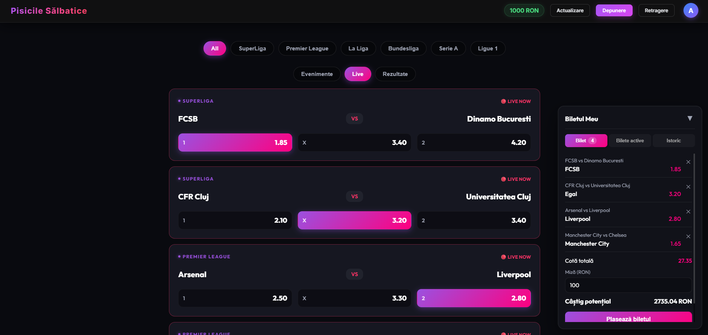

# Sports Betting Platform

A full-stack sports betting web app: user accounts with JWT authentication, live odds from an external
API, accumulator bets with server-side validation, automatic settlement and bet history.
No real money is involved — accounts start with a virtual balance.

University team project, Technical University of Cluj-Napoca (2026), built by a team of
three: Sebastian Mureșan ([@muresansebi999](https://github.com/muresansebi999)), Loli Vasile and
Cătălin Tira ([@tiracatalin](https://github.com/tiracatalin)).
Forked from [muresansebi999/SportsBettingApp](https://github.com/muresansebi999/SportsBettingApp).

<!-- TODO: capturi de ecran -->



## Features

- **Accounts:** registration with age check (18+), login with JWT, deposit and withdrawal
- **Matches:** six leagues with seeded fixtures, plus live odds and results from
  [The Odds API](https://the-odds-api.com)
- **Bet slip:** accumulator bets (1 / X / 2) with one selection per match
- **Settlement:** pending bets are settled once all their matches finish; winnings are credited
- **Bet history** per user

## Architecture

```
Angular 21 client  ──HTTP/JSON──>  ASP.NET Core 8 Web API  ──EF Core──>  SQLite
                                          │
                                          └──> The Odds API (odds + scores)
```

| Layer | Stack |
|---|---|
| Frontend | Angular 21, TypeScript, Playwright (e2e) |
| Backend | ASP.NET Core 8 Web API, Entity Framework Core, JWT bearer auth, Swagger |
| Database | SQLite with EF Core migrations |

## My contributions

- **Bet placement, settlement and history** — `BetsController`, `Bet` / `BetSelection` models and migration,
  bet slip component and Angular services
  ([`502c8e8`](https://github.com/muresansebi999/SportsBettingApp/commit/502c8e8)):
  - odds are recomputed on the server from the stored match, never trusted from the client
  - validation: positive stake, no duplicate match, no bets on started or finished matches
  - balance check and deduction run inside a database transaction, re-reading the balance to avoid
    double spending under concurrent requests
- **Match listing** in the Angular client and **database seeding** with fixtures

## Running locally

**Backend** (requires .NET 8 SDK):

```bash
cd Backend/BettingApp.API
dotnet ef database update
dotnet user-secrets set "OddsApi:ApiKey" "<your key>"   # optional, only for live odds
dotnet run
```

Swagger UI is available at `/swagger` in development. A test account is seeded:
`admin` / `password123`.

**Frontend** (requires Node.js):

```bash
cd BettingApp-Client
npm install
npm start          # http://localhost:4200
```

## Known limitations and next steps

This is a course project; before anything like production it would need:

- **Identity from the token, not the request:** bets are currently linked to the username sent in the
  request body. The fix is already prepared in `BetsController` — read the user id from the JWT claims.
- **Admin-only settlement:** `POST /api/bets/settle` needs a role check.
- **Password hashing:** HMAC-SHA512 should be replaced with a dedicated password hash
  (PBKDF2 / BCrypt / ASP.NET Identity's hasher).
- **Secrets:** the JWT signing key in `appsettings.json` is a development value and must come from
  a secret store in any real deployment.
